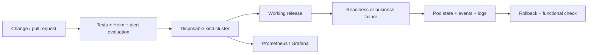

# release-lab

A small Kubernetes delivery lab with two deliberately broken releases and a recovery check for each.

The question it answers is simple: **after a deployment goes wrong, can we show what failed and prove that the previous version is working again?**

The workload is a tiny Python HTTP service. The engineering work is in the delivery path: a Helm chart, a disposable cluster, functional checks, diagnostic capture, monitoring, and a service configuration generator.

## Start here

| What to inspect | Where |
| --- | --- |
| Two failure drills and recovery assertions | [tools/lab.py](tools/lab.py) |
| Rollout strategy, probes, runtime restrictions | [Helm chart](charts/service) |
| Metrics, alert rules and dashboard | [monitoring](monitoring) |
| A new service's values and GitOps boundary | [Service generator](tools/new_service.py) |
| Actual checks completed so far | [Validation record](docs/validation.md) |
| Design choices and boundaries | [Decisions](docs/decisions.md) |
| Reproduce the demonstration | [Demo walkthrough](docs/demo.md) |

This is a personal engineering lab. It is not a production platform or a claim of production Kubernetes experience.

## The two drills

1. **Readiness regression.** The new pods start, but `/readyz` returns 503. The rollout times out. The check confirms that the fault actually ran, sends functional requests through the Kubernetes Service to the previous version, captures diagnostics, rolls back, and checks the response again.
2. **Business regression.** `/readyz` returns 200, but `/work` returns 503. Kubernetes accepts the rollout. A functional request catches the failure; the drill captures diagnostics, rolls back, and checks both the response digest and version.

Each completed drill writes its result, elapsed time, recovery time and verification attempts to `artifacts/e2e.json`. Recovery requires a passing functional sample within a bounded window after rollback. These are timings of a local exercise, not availability or recovery guarantees.



## Run without Kubernetes

Python 3.12 is used in CI. The application itself has no third-party Python dependencies.

```bash
python -m venv .venv
source .venv/bin/activate
python -m pip install -r requirements-dev.txt
python tools/bootstrap.py helm actionlint promtool
python tools/verify.py
```

On Windows, activate with `.venv\Scripts\Activate.ps1`. The bootstrap script downloads the pinned tools into `.tools/bin` and verifies their upstream SHA-256 checksums. It does not install system packages.

To inspect the workload directly:

```bash
python -m app.server
# In another terminal:
curl 'http://127.0.0.1:8080/work?value=hello'
curl http://127.0.0.1:8080/metrics
```

## Run the complete recovery exercise

Requirements: Python, a running Docker daemon with Linux containers, and enough memory for a local Kubernetes node. Allow roughly 4 GB for the exercise; monitoring adds more. No cloud account is used.

```bash
python tools/bootstrap.py helm kind kubectl
python tools/lab.py e2e
```

The command creates `release-lab`, builds and loads the image, deploys the working release, and runs both drills. It leaves the recovered service and cluster available for inspection. It uses `artifacts/lab.kubeconfig`; commands do not use your current Kubernetes context.

```bash
python tools/lab.py monitoring
python tools/check_monitoring.py
```

For the dashboard, keep this command running in another terminal:

```bash
.tools/bin/kubectl --kubeconfig artifacts/lab.kubeconfig -n release-lab \
  port-forward --address 127.0.0.1 svc/grafana 3000:3000
```

Open `http://127.0.0.1:3000/d/release-lab`. The lab uses anonymous, read-only dashboard access and a ClusterIP Service. Do not expose it publicly as configured.

Cleanup is explicit:

```bash
python tools/lab.py down
```

## Add a service through Git

[The GitOps walkthrough](docs/gitops.md) covers publishing an image, generating a service definition, and connecting a separate namespace to Argo CD. The generator requires an image digest and an owner. It writes files for review and never deploys them.

The recovery exercise uses Helm directly. The optional GitOps path uses Argo CD and Git reverts. They do not share ownership of a release.

## CI

`Verify delivery and recovery` runs on pull requests and pushes to `main`:

- Python HTTP tests, generated configuration checks, chart rendering, and invalid-input checks;
- Helm lint, workflow validation, and Prometheus alert evaluation;
- both recovery drills in kind;
- live monitoring configuration, per-pod scrape targets, and Grafana dashboard checks.

It uploads diagnostic evidence and removes its disposable cluster. There are no cloud credentials or deployment secrets in this workflow.

`Publish probe image` is a separate manual workflow. It publishes a commit-tagged image to GHCR, requests SBOM/provenance generation, and prints the immutable digest in the job summary. Read the validation record before treating any configured workflow as a completed run.

`Verify GitOps onboarding` deploys the checked-in demo through Argo CD, verifies a functional request, scales the Deployment manually, and checks that reconciliation restores the declared replica count.

## Scope

- One local cluster, one workload, no database or persistent application data.
- Prometheus stores two hours of disposable metrics. Alert rules are evaluated, but notifications are not wired to a paging service.
- Two replicas exercise rolling updates. A single kind node does not demonstrate node-level high availability.
- The optional NetworkPolicy needs a CNI that enforces it; the default exercise does not claim network isolation.
- Cloud provisioning, IAM, TLS ingress, persistent backups, and multi-tenant administration are outside this version.

Maintained by [Vladimir / isboston](https://github.com/isboston). Related professional work and a short review path are in [Engineering background](docs/background.md).
